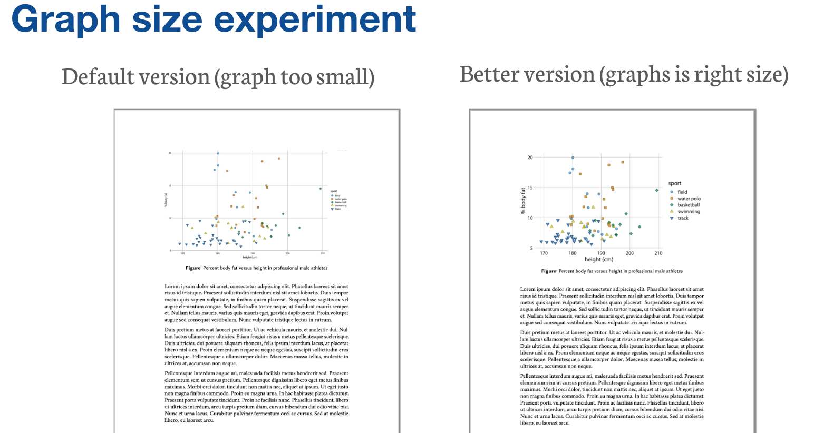
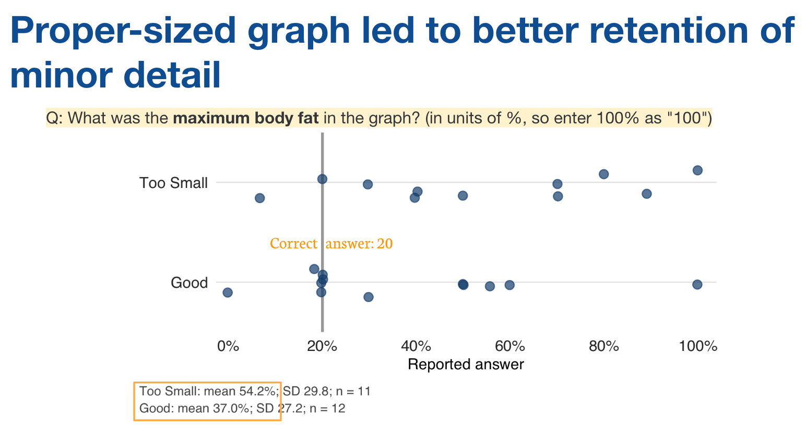

For this post, I will be sharing examples of how Shiro has used pre-class exercises\* during his lectures to connect with the students as they explore ideas before lecture and prepare for class discussions of research papers. The pre-class exercises guide students toward key sections and figures in the papers, then ask them to apply course concepts and evaluate research designs, as well as having the chance to ask questions that can be addressed during class.

Additionally, some pre-class exercises invite students to share their experiences relevant to the class concept. For example, one of the pre-class exercise questions asked about students’ involvement in randomized controlled trials or field surveys, giving Shiro examples to draw on during class. Students were also eager to connect their research experiences to the discussion. When Shiro asked about the practical demands of conducting interviews, one student shared their experience interviewing in rural areas, while another described conducting five interviews a day in Honduras. Most students turned to look at their classmates as they spoke. By inviting students to elaborate on experiences shared in the pre-class exercises, students could better see how the abstract research design concepts can apply to the students’ work.

Pre-class exercises can even contain a survey experiment on the students. In one exercise, students viewed a graph, but Shiro did not tell them beforehand that they were randomized into one of two versions of the same graph, one with small labels and symbols, and another with more readable sizing. Both groups were asked to recall a detail in the graph. The range of the y-axis. It turned out that students who saw the more readable version were more likely (by about 17 points on average) to recall or guess the right answer. This showed that graph design can affect our ability to retain information.

*Students were randomly shown one of two versions of the same graph.*

*Students' answers by version. The correct answer was 20%.*

Seeing their own answers made the lesson concrete, driving the point that the same quantity can be easier to judge accurately depending on how it is displayed. The exercises encouraged students to consider how their visualization choices, which they will have to make for their final project, could help or hinder readers' ability to interpret data accurately.

## What we noticed

Students seemed particularly intrigued by the perception experiments. The reveal of the collective tendency is satisfying and it drives a point for the student, whether it’s to be mindful of percent versus percentage points to how they choose the medium for visualizing information. I believe this will be more sticky than if Shiro just lectured about these points.

The design of the pre-class exercises explicitly encouraged students to enter their best guess, even if they did not know how to calculate the answer. This made their initial intuitions useful material for the lesson. During lecture, Shiro revealed to students that they were in a randomized experiment – they were asked different versions and connected the exercise to the challenges of interpreting percentages. This was also useful because the class was teaching them about randomization.

\*Shiro’s (Course Instructor) note: I learned this trick from [Dan Levy](/blog-teaching/dan-levy-uncover/), one of my teaching mentors as a TF. The term pre-class exercise comes from Dan as well.
